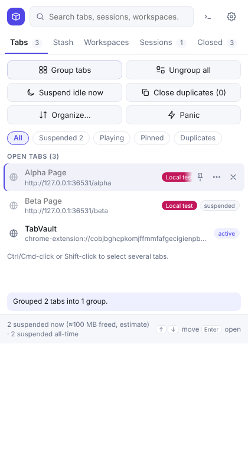
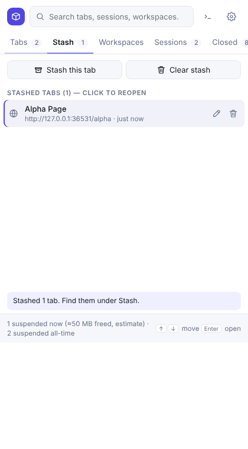
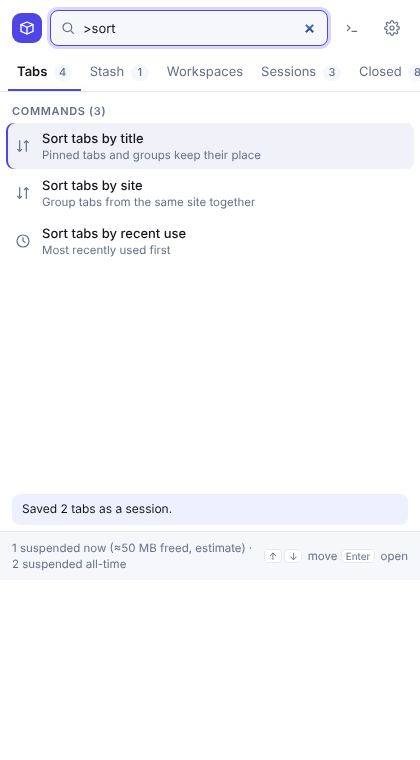
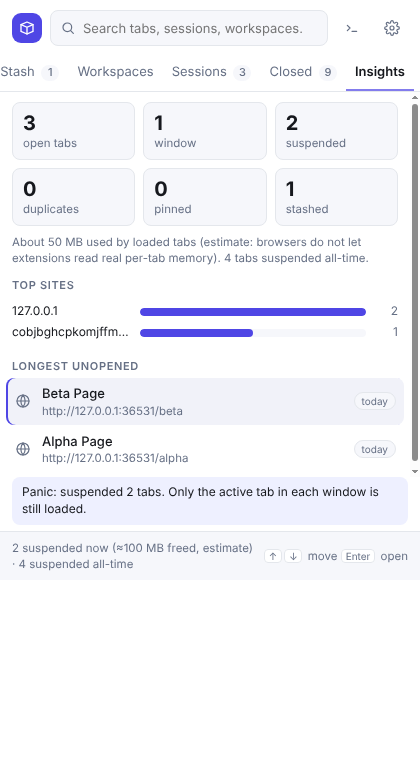

<div align="center">


# TabVault

**Fast, private tab and session manager for Chrome and Brave.**
Suspend idle tabs, switch workspaces, restore sessions, and search everything you have open or saved.

[](../../actions/workflows/ci.yml)


</div>

<p align="center">
  
  
  
  
  
  
</p>

## Why TabVault

- **Local-first and private.** No account, no server, no analytics, no remote code. It never reads page content and asks for **no host permissions**.
- **Safe by default.** Switching workspaces always saves your current tabs first; automatic snapshots every 15 minutes are your undo button.
- **Fast.** Native `tabs.discard` suspending, a tiny bundle (~125 KB), and typo-tolerant search over thousands of tabs.
- **Open source** (MIT) and tested: unit tests plus an end-to-end test that drives the real extension in Chromium.

## Features

| | |
|---|---|
| **Auto-suspend** | Discards tabs idle for N minutes (default 30). Skips the active tab, pinned and audible tabs (both opt-in), browser pages and a site whitelist. |
| **Smart grouping** | One click (or automatic, opt-in) groups tabs into native tab groups: your rules first, then categories (Dev, Mail, Video…), then by site. Pinned and already-grouped tabs are never touched. Runs entirely on-device, no AI service. |
| **Workspaces** | Named tab sets. Click to switch; the outgoing tabs are saved into the old workspace (or an auto snapshot) before anything is closed. |
| **Sessions** | Save a window and restore it later, with its tab groups (names and colors) back in place. Automatic snapshots (latest 10 kept) protect against crashes and accidents. |
| **Tab list** | Filter open tabs (Suspended, Playing, Pinned, Duplicates). Pin, suspend or close any tab from its row; the **⋯** menu stashes it, adds a note, moves it to another window or protects its site. Ctrl/Cmd-click or Shift-click to select several tabs, then stash, group, save or close them. |
| **Stash** | Park a tab for later: saved, then closed. Shortcut **Alt+Shift+S**. Reopen it from the Stash view. |
| **Notes and tags** | Attach a note and `#tags` to any page. They are searchable and shown on the tab, the stash and saved results. |
| **Command palette** | **Ctrl/Cmd+K** (or type `>`) runs any action by name: group, sort, merge windows, panic, back up, theme... |
| **Sort and merge** | Sort a window by title, site or recent use (pinned tabs and tab groups keep their place), or merge every window into one. |
| **Panic** | One click (or **Alt+Shift+P**) suspends every tab except the active one in each window. |
| **Scheduled workspaces** | Open a workspace automatically at a set time on chosen days, in a new window. |
| **Archive stale tabs** | Opt-in: tabs you have not opened for N days are saved into an Archive session and closed. |
| **Insights** | Open tabs, windows, suspended and duplicate counts, top sites, and the tabs you have left alone longest. |
| **Search** | Fuzzy search across open tabs, sessions and workspaces with ↑ ↓ Enter navigation. |
| **Duplicates** | The toolbar icon shows a badge with the number of duplicate tabs (turn it off in settings). One click closes duplicates, or opt in to switching to the existing tab instead of opening a copy. |
| **Recently closed** | The Closed tab lists tabs and windows you closed lately; click to reopen them. |
| **Backup** | Export/import sessions, workspaces, stash, notes and settings as JSON, or save a backup file automatically every N days. Imports are validated and only http(s) URLs are accepted. |
| **Sync** | Settings follow you via your browser's own sync (`chrome.storage.sync`), if enabled. |
| **Theming and a11y** | Light, dark or system theme, comfortable or compact density, keyboard friendly, ARIA roles. |

Shortcuts (change them at `chrome://extensions/shortcuts`): **Ctrl/Cmd+Shift+K** opens TabVault, **Alt+Shift+S** stashes the current tab, **Alt+Shift+P** panics, **Alt+Shift+G** groups the window. Press **?** in the popup for the full list.

## Install

**From a release (works in Chrome and Brave):**
1. Download `tabvault-*-chrome.zip` from the [Releases](../../releases) page and unzip it.
2. Open `chrome://extensions` (or `brave://extensions`), enable **Developer mode**.
3. Click **Load unpacked** and select the unzipped folder.

**From source:**

```bash
git clone https://github.com/Digvijay-Chavda/tab-vault && cd tab-vault
npm install
npm run build        # output in .output/chrome-mv3
```

Chrome Web Store listing text and permission justifications are in [docs/STORE_LISTING.md](docs/STORE_LISTING.md).

## Permissions

| Permission | Why |
|---|---|
| `tabs` | Read tab titles/URLs for the list and search; suspend idle tabs |
| `tabGroups` | Create and name tab groups for smart grouping (group titles and colors only) |
| `storage` | Save settings locally (and via browser sync) |
| `sessions` | List recently closed tabs/windows so you can reopen them |
| `downloads` | Save a backup file when you ask for one (or on your schedule) |
| `alarms` | Idle check every minute, snapshots every 15 minutes (MV3 workers can't use timers) |

Read the full [privacy policy](PRIVACY.md).

## Known limitations

- Suspending discards the page, so **unsaved form input in a suspended tab is lost** (the same as Chrome's own memory saver). Whitelist sites where this matters, or turn off auto-suspend in settings.
- The "MB freed" figure in the footer is a rough estimate (≈50 MB per tab), not a measurement.
- Smart grouping uses a built-in list of well-known sites plus your own rules; it does not read page content, so it can't group by topic.
- Group titles and colors are not stored in sessions or workspaces yet; restored tabs come back ungrouped.
- Brave and Chrome are supported. A Firefox build exists (`npm run build:firefox`) but is untested: Firefox's tab-group support differs, so grouping features hide themselves where the browser has none.
- Memory figures are estimates; browsers do not let extensions read real per-tab memory.
- Scheduled workspaces, auto-archive and scheduled backups run while the browser is open.

## Develop

```bash
npm install
npm run dev                          # Chrome with hot reload
npm run check && npm run lint && npm test
npm run build && npm run e2e         # set CHROMIUM_PATH to use your own Chromium
npm run zip                          # store-ready zip in .output/
npm run build:firefox                # experimental Firefox (MV3) build
```

### Architecture

```
src/
  entrypoints/
    background.ts     # MV3 service worker: alarms (idle sweep, snapshots), tab activity tracking
    popup/            # Toolbar popup: Tabs / Workspaces / Sessions / Closed views + search (plain TypeScript, textContent only)
    options/          # Settings, backup export/import
  core/
    rules.ts          # pure suspend decision (unit tested)
    activity.ts       # last-active timestamps in storage.session (the worker is ephemeral)
    workspaces.ts     # switch = save outgoing tabs first, open new, then close old
    sessions.ts       # sessions + auto snapshots + pruning
    search.ts         # MiniSearch index
    grouping.ts       # pure smart-grouping planner (rules > category > site), unit tested
    grouping-apply.ts # applies a plan with chrome.tabGroups
    backup.ts         # validate/sanitize untrusted import files
    settings*.ts      # settings schema, sync-with-local-fallback storage
  storage/db.ts       # Dexie (IndexedDB) with versioned schemas
tests/unit            # Vitest
tests/e2e             # Playwright drives the built extension
```

Key design rules: every `chrome.*` listener is registered synchronously at the top level of the worker; no state lives in memory; untrusted page text is only rendered with `textContent`. See [CONTRIBUTING.md](CONTRIBUTING.md).

## License

[MIT](LICENSE)
